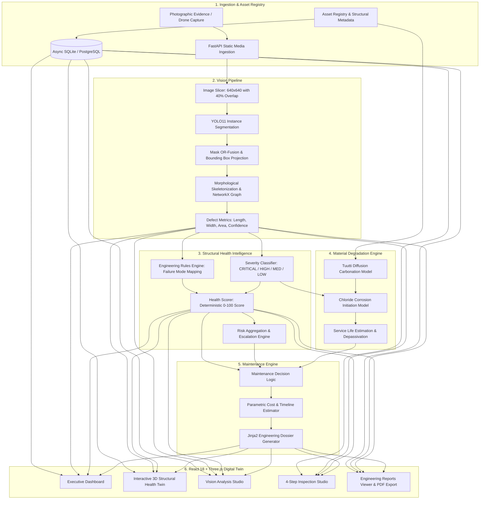

# SHM-AI

<div align="center">

### AI-Directed Predictive Maintenance & Structural Health Monitoring Platform

*A modular engineering platform combining Computer Vision, Civil Structural Intelligence, Material Degradation Physics, and Interactive 3D Digital Twin Visualizations for automated infrastructure asset inspection.*

[](https://www.python.org/)
[](https://fastapi.tiangolo.com/)
[](https://react.dev/)
[](https://www.typescriptlang.org/)
[](https://threejs.org/)
[](https://ultralytics.com/)
[](https://pytest.org/)
[](#current-progress)
[](https://github.com/fardh3en/SHM---AI-)

</div>

---

## Table of Contents

- [Overview](#overview)
- [System Architecture](#system-architecture)
- [Core Engineering Modules](#core-engineering-modules)
  - [1. Computer Vision Engine](#1-computer-vision-engine)
  - [2. Structural Health Intelligence](#2-structural-health-intelligence)
  - [3. Material Degradation Modeling](#3-material-degradation-modeling)
  - [4. Maintenance Recommendation Engine](#4-maintenance-recommendation-engine)
  - [5. Interactive 3D Digital Twin](#5-interactive-3d-digital-twin)
  - [6. Vision Analysis Studio](#6-vision-analysis-studio)
  - [7. Inspection Studio](#7-inspection-studio)
  - [8. Automated Engineering Reports](#8-automated-engineering-reports)
- [Project Directory Structure](#project-directory-structure)
- [Implementation Progress](#implementation-progress)
- [Technology Stack](#technology-stack)
- [Getting Started](#getting-started)
  - [Prerequisites](#prerequisites)
  - [Backend Setup](#backend-setup)
  - [Model Weights Provisioning](#model-weights-provisioning)
  - [Evidence & Database Seeding](#evidence--database-seeding)
  - [Running the Backend API](#running-the-backend-api)
  - [Frontend Setup & Dev Server](#frontend-setup--dev-server)
- [API Reference](#api-reference)
- [Testing & Quality Assurance](#testing--quality-assurance)
- [Environment Configuration](#environment-configuration)
- [License](#license)

---

## Overview

**SHM-AI** is an industrial-grade structural health monitoring and predictive maintenance platform engineered for civil infrastructure owners, inspection engineers, and asset managers.

Traditional inspection workflows rely on manual visual checks, disjointed paper reports, and subjective damage categorizations. SHM-AI unifies the end-to-end inspection lifecycle into an automated, deterministic, and verifiable pipeline:

1. **Photographic & Sensor Ingestion**: High-resolution drone, handheld, or sensor imagery attached to structured asset records.
2. **Defect Localization & Quantification**: Ultralytics YOLO11 instance segmentation, overlap-aware image slicing, morphological skeletonization, and pixel-to-millimeter metric estimation.
3. **Engineering Assessment**: Codified structural mechanics (ACI 318 / Eurocode 2) assessing failure modes, severity levels, and computing a deterministic 0–100 Health Score.
4. **Degradation & Service Life Projection**: Physics-based Tuutti diffusion models evaluating concrete carbonation depth, depassivation horizons, and chloride-induced rebar corrosion propagation.
5. **Actionable Recommendations**: Algorithmic intervention classification (Monitor, Inspect, Repair, Replace, Emergency), budget forecasting, and scheduled maintenance timelines.
6. **Interactive 3D Digital Twins**: Three.js parametric visualization across six core civil typologies (Bridges, Flyovers/Roads, Dams, Tunnels, Buildings, Pipelines) with defect heatmap projection and component picking.
7. **Official Dossiers & Engineering Reports**: Jinja2 templated engineering documentation compiling diagnostics, defect telemetry, and maintenance plans for executive review and printable archival.

---

## System Architecture



---

## Core Engineering Modules

### 1. Computer Vision Engine
- **Model**: Ultralytics YOLO11 instance segmentation (`yolo11n-seg.pt` or custom structural weights).
- **High-Resolution Slicing**: Slices large-format structural images into 640×640 tiles with 40% spatial overlap to detect hairline fractures without downsampling artifacts.
- **Topological Analysis**: Uses morphological skeletonization (`skimage.morphology.skeletonize`) and 8-connectivity convolution kernels to build NetworkX graphs, accurately extracting branch lengths, widths, and junction topologies.
- **Measurement Precision**: Extrapolates physical crack dimensions, area bounding envelopes, and GeoJSON-compatible polygon coordinates.

### 2. Structural Health Intelligence
- **Deterministic 0–100 Health Score**: Evaluates defect quantity, area densities, and critical structural positions.
- **Failure Mode Inference**: Maps crack morphology and orientation to fundamental structural mechanisms (e.g., vertical shear in web walls, flexural tension at mid-span, diagonal shear at support boundaries, punching shear around column connections).
- **Severity Classification**: Adheres to international concrete structural standards (ACI 224R-01, Eurocode 2) classifying damage into `CRITICAL`, `HIGH`, `MEDIUM`, or `LOW`.

### 3. Material Degradation Modeling
- **Decoupled Physics**: Standalone deterministic engineering models with zero ORM coupling.
- **Carbonation Model**: Simulates carbonation front progression via square-root-of-time diffusion:
  $$d_c(t) = k_c \cdot \sqrt{t}$$
  with water/cement ratio and exposure class adjustments (EN 206 XC1–XC4).
- **Corrosion Model**: Calculates steel depassivation time ($t_{\text{dep}} = (\text{cover} / k_c)^2$) and simulates post-initiation corrosion propagation using exponential saturation:
  $$\text{Corrosion Index} = 1 - e^{-\tau / \tau_{\text{sat}}}$$
- **Conservative Maintenance Trigger**: Automatically triggers maintenance requirements if observed severe physical defects are present, even if theoretical carbonation has not reached depth cover.

### 4. Maintenance Recommendation Engine
- **Intervention Classifier**: Translates health scores and risk profiles into actionable directives:
  - `75–100`: **Monitor** (scheduled re-inspection cycle)
  - `50–74`: **Inspect** (NDT acoustic/ultrasonic testing)
  - `25–49`: **Repair** (epoxy injection, structural reinforcement within 6 months)
  - `0–24`: **Emergency** (immediate load restriction and structural intervention)
- **Parametric Cost Estimator**: Quantifies mobilization, labor, and material costs based on defect type, surface square footage, and access constraints.

### 5. Interactive 3D Digital Twin
- **Three.js WebGL Engine**: Responsive, hardware-accelerated 3D viewport embedded in the web workspace.
- **Typology Geometries**: Parametric structural models customized for actual civil asset classifications:
  - **Bridges**: Decks, support piers, abutments, cable-stayed/suspension towers.
  - **Roads / Flyovers**: Elevated multi-span expressways, parapets, pier columns.
  - **Dams**: Arch and gravity reservoir barrier faces, intake towers, spillways.
  - **Tunnels**: Vaulted concrete liners, invert slabs, portal entries.
  - **Buildings**: Multi-story framed columns, slabs, and shear walls.
  - **Pipelines**: Cylindrical conduits, joint collars, cradle supports.
- **Interactive Capabilities**: Component selection, camera focus/reset, defect severity heatmap shading, and attached inspection evidence linking.

### 6. Vision Analysis Studio
- **Dual Photographic Viewports**: Split-screen juxtaposition of original photographic evidence against the YOLOv11 defect localization canvas.
- **Vector Overlays**: Interactive SVG bounding boxes, translucent polygon masks, and hover inspection cards.
- **Defect Metrics Breakdown**: Confidence scores, millimeter width/length measurements, and automated classification summaries.

### 7. Inspection Studio
- **Guided 4-Step Pipeline**:
  1. *Asset Selection*: Choose from verified assets or create new records.
  2. *Evidence Attachment*: Upload high-resolution inspection imagery or select from verified asset archives.
  3. *Pipeline Execution*: Trigger automated YOLOv11 segmentation and intelligence scoring.
  4. *Diagnostic Recovery & Findings*: Comprehensive findings report with interactive retry, evidence validation, and weight provisioning guides.

### 8. Automated Engineering Reports
- **Jinja2 HTML Templating**: Formats comprehensive structural audit documents.
- **Executive Dossier**: Synthesizes structural specs, detected defects, health indices, degradation forecasts, and recommended remedial timelines.
- **Export Formats**: In-browser interactive preview, direct HTML download, and print-ready PDF styling.

---

## Project Directory Structure

```
SHM-AI/
├── backend/                  # FastAPI Application Core
│   └── app/
│       ├── api/v1/           # API v1 REST Routes
│       │   ├── endpoints/    # assets, evidence, inspections, reports, system
│       │   └── router.py     # Aggregated v1 API router
│       ├── core/             # Logging, security, base exceptions
│       ├── database/         # Async SQLAlchemy engine & session factory
│       ├── models/           # Declarative ORM models (Asset, Inspection, Detection, etc.)
│       ├── schemas/          # Pydantic v2 validation contracts
│       ├── services/         # Domain business logic (AssetService, InspectionService, etc.)
│       ├── config.py         # Type-safe configuration via Pydantic BaseSettings
│       └── main.py           # FastAPI factory, lifespan, CORS, and static file mounts
├── frontend/                 # React 18 + TypeScript + Vite Single-Page Application
│   ├── src/
│   │   ├── api/              # Axios/Fetch API client wrappers
│   │   ├── components/       # Shared UI primitives (AppShell, Navigation, Modal, Toast)
│   │   ├── features/         # Feature modules
│   │   │   ├── assets/       # Asset Registry and Asset Detail
│   │   │   ├── dashboard/    # Executive KPI Dashboard
│   │   │   ├── home/         # Landing and platform overview
│   │   │   ├── inspections/  # 4-step Inspection Studio and Diagnostic Card
│   │   │   ├── reports/      # Engineering Reports compiler and viewer
│   │   │   ├── vision/       # Vision Analysis Studio with defect localization
│   │   │   └── visualization/# Three.js 3D Structural Health Twin
│   │   ├── tokens/           # Design system tokens and styling variables
│   │   ├── App.tsx           # Route definitions
│   │   └── main.tsx          # Application entry point
│   ├── package.json          # Frontend dependencies & scripts
│   └── vite.config.ts        # Vite configuration & proxy settings
├── vision/                   # Computer Vision Package
│   ├── detectors/            # YOLO11 detector implementations
│   ├── pipeline/             # Detection & segmentation orchestration
│   ├── postprocessing/       # Slicing, skeletonization, NetworkX crack graphs
│   ├── preprocessing/        # Image loading and tiling
│   └── schemas.py            # Vision I/O schemas
├── intelligence/             # Structural Health Intelligence
│   ├── scoring/              # 0-100 Health Score calculation
│   ├── engineering_rules.py  # Codified structural failure mechanisms
│   ├── risk_engine.py        # Multi-defect risk aggregation
│   ├── severity_classifier.py# Defect severity grading
│   └── assessment_service.py # Orchestrator
├── degradation/              # Deterministic Material Degradation
│   ├── carbonation.py        # Square-root diffusion carbonation model
│   ├── corrosion.py          # Chloride depassivation & corrosion index
│   ├── service_life.py       # Service life estimator & maintenance decision
│   └── config.py             # Physical coefficient lookup tables
├── recommendation/           # Actionable Maintenance Decision Engine
│   ├── engine.py             # Action classification (Monitor/Inspect/Repair/Replace)
│   ├── cost_estimator.py     # Parametric cost calculation
│   ├── report_generator.py   # Jinja2 HTML dossier generation
│   └── templates/            # HTML dossier template (report.html.j2)
├── scripts/                  # Operational & Seed Scripts
│   ├── download_weights.py   # Automated/explicit YOLO11 weights provisioning
│   ├── run_dev.py            # Backend development server runner
│   ├── seed_evidence.py      # Civil engineering archive & Wikimedia photo ingestion
│   └── seed_db.py            # Database mock and baseline asset generator
├── tests/                    # Test Suite (440 passing tests)
│   └── unit/                 # Unit tests covering backend, vision, degradation, intelligence
├── weights/                  # Model weights storage (yolo11n-seg.pt)
├── reports/                  # Generated HTML/PDF inspection reports
├── datasets/                 # Training and benchmarking datasets
└── pyproject.toml            # Project metadata and Python dependencies
```

---

## Implementation Progress

| Phase | Description | Status |
|:---|:---|:---:|
| **Phase 1: Backend Foundation** | FastAPI architecture, Async SQLAlchemy, SQLite/PostgreSQL, CRUD models | ✅ Complete |
| **Phase 2: Vision Engine** | YOLO11 instance segmentation, sliced inference, skeletonization, crack graphs | ✅ Complete |
| **Phase 3: Structural Intelligence** | 0–100 Health Score, failure mode mapping, severity classification, risk engine | ✅ Complete |
| **Phase 4: Material Degradation** | Deterministic Tuutti carbonation model, chloride corrosion, service life | ✅ Complete |
| **Phase 5: Recommendation & Reports**| Maintenance decision engine, cost estimator, Jinja2 engineering dossiers | ✅ Complete |
| **Phase 6: Web Engineering Workspace**| React 18 + Vite, Three.js 3D Health Visualizer, Vision Studio, Inspection Studio | ✅ Complete |
| **Phase 7: Production Deployment** | Multi-stage Docker, GPU inference containerization, Nginx, CI/CD pipeline | 🔜 Planned |

---

## Technology Stack

| Layer | Component | Technologies |
|:---|:---|:---|
| **Backend API** | Framework | FastAPI 0.115+, Uvicorn (ASGI) |
| **Data & ORM** | Storage & Queries | SQLAlchemy 2.0 (Async), aiosqlite, Alembic |
| **Data Validation** | Schema Contracts | Pydantic v2, Pydantic-Settings |
| **Frontend UI** | Client Workspace | React 18.3, TypeScript 5.6, Vite 6.0, Tailwind CSS |
| **3D Graphics** | WebGL Visualization | Three.js r186, OrbitControls |
| **Computer Vision** | Deep Learning & Geometry | Ultralytics YOLO11, PyTorch, OpenCV, Scikit-Image, NetworkX, Shapely |
| **Reporting** | Document Generation | Jinja2, WeasyPrint |
| **Testing** | Verification | Pytest (pytest-asyncio, pytest-cov), ESLint, TypeScript `tsc` |

---

## Getting Started

### Prerequisites
- **Python**: `>= 3.11`
- **Node.js**: `>= 18.x` (with `npm`)
- **Git**

### Backend Setup

1. **Clone the repository:**
   ```bash
   git clone https://github.com/fardh3en/SHM---AI-.git
   cd SHM---AI-
   ```

2. **Create and activate a Python virtual environment:**
   ```bash
   # Windows
   python -m venv .venv
   .venv\Scripts\activate

   # Linux / macOS
   python3 -m venv .venv
   source .venv/bin/activate
   ```

3. **Install dependencies:**
   ```bash
   pip install -e ".[dev,vision,reports]"
   ```

### Model Weights Provisioning

SHM-AI includes an automated weight provisioner with user consent validation:

```bash
# Non-interactive download of YOLO11 segmentation weights (~6 MB)
python scripts/download_weights.py --yes
```

The model file will be saved directly to `weights/yolo11n-seg.pt`.

### Evidence & Database Seeding

Populate the database with civil engineering structural assets and genuine photographic inspection evidence:

```bash
# Seed genuine structural evidence from open civil engineering archives
python scripts/seed_evidence.py

# (Optional) Seed demonstration asset inventory
python scripts/seed_db.py
```

### Running the Backend API

Start the FastAPI development server:

```bash
python scripts/run_dev.py
```
*or directly with Uvicorn:*
```bash
uvicorn backend.app.main:app --host 127.0.0.1 --port 8000 --reload
```

- **Swagger UI Documentation**: [http://localhost:8000/api/v1/docs](http://localhost:8000/api/v1/docs)
- **ReDoc Interactive Documentation**: [http://localhost:8000/api/v1/redoc](http://localhost:8000/api/v1/redoc)
- **Health Check**: [http://localhost:8000/api/v1/system/health](http://localhost:8000/api/v1/system/health)

### Frontend Setup & Dev Server

1. **Navigate to the frontend directory:**
   ```bash
   cd frontend
   ```

2. **Install frontend packages:**
   ```bash
   npm install
   ```

3. **Launch the Vite development server:**
   ```bash
   npm run dev
   ```

The application will be accessible at:
👉 **[http://localhost:3000](http://localhost:3000)**

---

## API Reference

### System
- `GET /api/v1/system/health` — System status, database health, environment check.

### Asset Management
- `GET /api/v1/assets` — Query all registered infrastructure assets.
- `POST /api/v1/assets` — Register a new structural asset.
- `GET /api/v1/assets/{id}` — Fetch detailed asset metadata and component definitions.
- `PUT /api/v1/assets/{id}` — Update asset configuration.
- `DELETE /api/v1/assets/{id}` — Soft/hard delete an asset record.

### Photographic Evidence
- `GET /api/v1/assets/{id}/evidence` — List photographic evidence attached to an asset.
- `POST /api/v1/assets/{id}/evidence` — Upload high-resolution inspection media.

### Inspection Pipeline
- `GET /api/v1/inspections` — List historical inspection records.
- `POST /api/v1/inspections` — Initialize a new inspection session.
- `GET /api/v1/inspections/{id}` — Get inspection state, health scores, and metrics.
- `POST /api/v1/inspections/{id}/execute-vision` — Execute YOLO11 segmentation and structural intelligence scoring.
- `GET /api/v1/inspections/{id}/detections` — Retrieve defect bounding boxes, polygon coordinates, and measurements.

### Engineering Reports
- `POST /api/v1/reports/inspections/{id}/generate` — Compile Jinja2 HTML structural health dossier.
- `GET /api/v1/reports/{id}/download` — Download compiled HTML report dossier.

---

## Testing & Quality Assurance

The codebase maintains strict automated test coverage across all domain modules.

### Backend Unit Tests
Execute the complete test suite (440 passing unit tests):

```bash
# Run all tests
pytest tests/ -v

# Run with coverage report
pytest tests/ --cov=backend --cov=vision --cov=intelligence --cov=degradation --cov=recommendation
```

### Frontend Verification
Verify type safety, code styling, and production bundle compilation:

```bash
cd frontend

# TypeScript strict type-check
npm run type-check

# ESLint code styling check
npm run lint

# Production bundle build
npm run build
```

---

## Environment Configuration

Configuration values are managed by `backend/app/config.py` and can be overridden via a `.env` file in the project root:

| Key | Default Value | Description |
|:---|:---|:---|
| `APP_NAME` | `SHM-AI Platform` | Display name of the application |
| `APP_ENV` | `development` | Runtime mode (`development`, `staging`, `production`) |
| `DEBUG` | `true` | Enables verbose debug mode |
| `DATABASE_URL` | `sqlite+aiosqlite:///./data/shm_ai.db` | Async connection string (supports PostgreSQL) |
| `DEFAULT_MODEL_NAME` | `yolo11n-seg.pt` | Active YOLO segmentation model filename |
| `CONFIDENCE_THRESHOLD`| `0.25` | Minimum detection confidence |
| `IOU_THRESHOLD` | `0.45` | Non-Maximum Suppression (NMS) intersection threshold |
| `SLICE_HEIGHT` | `640` | Sliced inference tile height (px) |
| `SLICE_WIDTH` | `640` | Sliced inference tile width (px) |
| `SLICE_OVERLAP_RATIO` | `0.40` | Overlap ratio between adjacent inference tiles |

---

## License

This project is licensed under proprietary engineering terms. All rights reserved.
